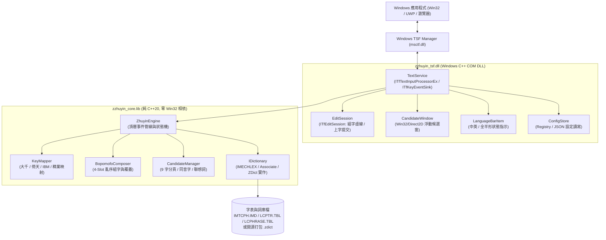
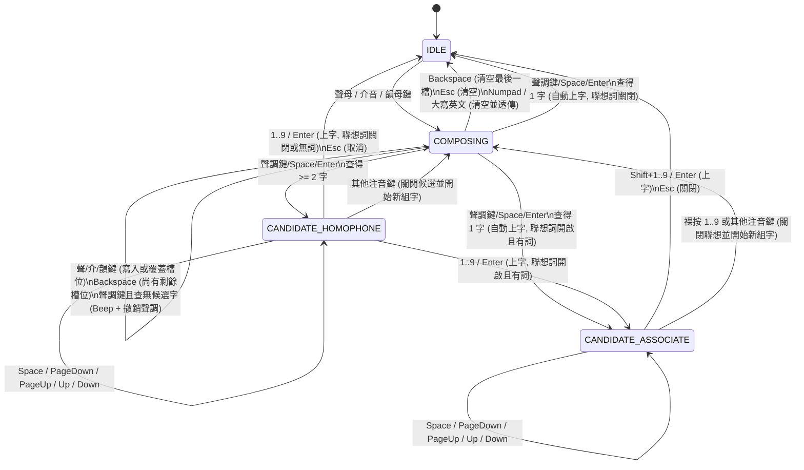

# `ZZhuyin` 完整規格書與 TSF 實作藍圖

本文件彙整 Phase 1～4 對 Windows 7 傳統注音（`phon.ime` + `IMTCCORE.DLL` + `IMTCCFG.DLL` + `IMTCPH.IMD` + `LCPTR.TBL` / `LCPHRASE.TBL`）的逆向工程成果，作為 **`ZZhuyin`（Windows TSF 傳統注音輸入法）** 的權威開發規格與實作藍圖。

- 來源依據：
  - [Phase 1：`phon.ime` 邊界與 COM 呼叫契約](file:///e:/Workspace/ZZhuyin/docs/phase-1-phon-ime-boundary.md)
  - [Phase 2：`IMTCCORE.DLL` 詞庫／字表路徑與格式盤點](file:///e:/Workspace/ZZhuyin/docs/phase-2-dictionary-format.md)
  - [Phase 3：注音鍵位映射與拼字狀態機](file:///e:/Workspace/ZZhuyin/docs/phase-3-bopomofo-state-machine.md)
  - [Phase 4：候選字排序、選字視窗與相容設定](file:///e:/Workspace/ZZhuyin/docs/phase-4-candidate-and-config.md)
  - 實檔驗證腳本：[tools/parse_dict.py](file:///e:/Workspace/ZZhuyin/tools/parse_dict.py)

---

## 1. 專案定位與核心行為原則

`ZZhuyin` 的目標是在現代 Windows（Windows 10 / 11，x64 / ARM64，含 Win32 與 UWP 應用程式）上，以 **TSF（Text Services Framework）** 精準復刻 Windows 7 傳統注音（「ㄅ半」，原 `HKL = 0xE0010404`、`Mode ID = 3`、`ProfileID = 0x01`）的手感與規則：

1. **純單字組字模式**：不啟用長句自動選字、不啟用 N-gram 語意模型、不啟用模糊音或智慧中英切換。
2. **純靜態固定候選排序**：候選字順序完全固定（與 `IMTCPH.IMD` Section 4 預排順序一致），**不做動態常用字調整（MRU）或個人詞頻學習**，確保肌肉記憶百分之百穩定。
3. **4-Slot 亂序拼字與同類音覆蓋**：允許任意順序輸入聲／介／韻母，同槽位後鍵覆蓋前鍵，並即時重排為正規順序。
4. **經典操作體驗**：
   - 不合法注音組合時發出提示音（Beep）並僅撤銷聲調鍵，保留原聲／介／韻母。
   - 唯一候選字無條件直接上字。
   - 每頁固定 9 字（`1`～`9` 選字、`Space`/`PageDown` 循環翻頁、`PageUp` 不循環）。
   - 支援「相關字詞（聯想詞）」視窗，採 `Shift + 1..9` 選詞，裸按 `1..9` 自動關閉並透傳組字。

---

## 2. 系統架構與技術選型

### 2.1 語言與分層決策

建議全專案採用 **C++20 + CMake（MSVC / Clang-CL）**，拆分為零 UI 相依的純邏輯核心庫與薄型 TSF COM 外殼：

- **為何選擇純 C++20 核心**：TSF 外殼本質上是 Windows COM DLL（C++ / Win32），核心引擎若同為標準 C++20 靜態庫（`zzhuyin_core`），無須跨越 FFI 邊界，同時完全不 `#include <windows.h>`，可直接透過 GoogleTest / Catch2 獨立執行毫秒級單元測試。
- *(備選方案)*：若未來希望核心跨平台或以 Rust 撰寫，只需維持第 6 節的介面邊界，將 `zzhuyin_core` 替換為 Rust crate + C ABI 封裝即可，TSF 層無須重寫。

### 2.2 模組架構圖



### 2.3 建議專案目錄結構

```text
ZZhuyin/
├── CMakeLists.txt
├── docs/                           # 逆向文件與本規格書
├── tools/
│   ├── parse_dict.py               # IMTCPH.IMD 驗證工具（已完成）
│   └── build_zdict.py              # (選配) 開源字表轉換打包工具
├── src/
│   ├── core/                       # zzhuyin_core (純標準 C++20)
│   │   ├── types.h                 # KeyEvent, Action, EngineConfig, ReadingCode
│   │   ├── key_mapper.h/.cpp       # 4 種鍵盤配置與標點表
│   │   ├── composer.h/.cpp         # 4-Slot 組字與覆蓋演算法
│   │   ├── dictionary.h            # IDictionary 介面
│   │   ├── imechlex_dict.h/.cpp    # IMTCPH.IMD / IMTCPHCS.IMD / LCPTR / LCPHRASE 讀取器
│   │   ├── candidate.h/.cpp        # 9 字分頁、游標循環與聯想詞切換
│   │   └── engine.h/.cpp           # 完整事件處理管線與狀態機
│   └── tsf/                        # zzhuyin_tsf.dll (Win32 / COM / TSF)
│       ├── dll_main.cpp            # COM 工廠與 RegSvr32 註冊
│       ├── text_service.h/.cpp     # ITfTextInputProcessorEx / ITfKeyEventSink
│       ├── edit_session.h/.cpp     # 組字更新、提交與游標座標查詢
│       ├── display_attr.h/.cpp     # 組字底線屬性 (ITfDisplayAttributeProvider)
│       ├── candidate_wnd.h/.cpp    # 浮動候選視窗 (高 DPI / 橫直排)
│       ├── lang_bar.h/.cpp         # 系統匣語言列按鈕
│       └── config_reg.h/.cpp       # 設定持久化
└── tests/                          # GoogleTest / Catch2 單元測試 (對齊第 9 節矩陣)
    ├── test_dictionary.cpp
    ├── test_composer.cpp
    ├── test_candidate.cpp
    └── test_engine_e2e.cpp
```

---

## 3. 資料檔格式與查詢規格

### 3.1 16-bit 注音內部編碼

所有注音音節統一編碼為 `uint16_t`（已在 `IMTCPH.IMD` 與 `FUN_7ff4085efc0` 雙重驗證）：

| Bit 區間 | 寬度 | 欄位 | 數值範圍與對應符號 |
|---|---:|---|---|
| `bits 15..11` | 5 bits | **聲母（Initial）** | `0` = 無；`1..21` = `ㄅㄆㄇㄈㄉㄊㄋㄌㄍㄎㄏㄐㄑㄒㄓㄔㄕㄖㄗㄘㄙ` |
| `bits 10..9` | 2 bits | **介音（Medial）** | `0` = 無；`1` = `ㄧ`、`2` = `ㄨ`、`3` = `ㄩ` |
| `bits 8..5` | 4 bits | **韻母（Final）** | `0` = 無；`1..13` = `ㄚㄛㄜㄝㄞㄟㄠㄡㄢㄣㄤㄥㄦ` |
| `bits 4..2` | 3 bits | **聲調（Tone）** | `0` = 未指定；`1` = 一聲、`2` = 二聲 `ˊ`、`3` = 三聲 `ˇ`、`4` = 四聲 `ˋ`、`5` = 輕聲 `˙` |
| `bits 1..0` | 2 bits | 保留 | 固定為 `0` |

- **編碼公式**：`code = (initial << 11) | (medial << 9) | (final << 5) | (tone << 2)`
- **O(1) 倒排索引 Bucket**：`bucket = code >> 2`（範圍 `0..16383`）。

### 3.2 `IMECHLEX` v2 格式（`IMTCPH.IMD`）

Little-endian，56-byte 標頭：

| Offset | Type | 欄位 | 驗證規則 |
|---:|---|---|---|
| `0x00` | `char[8]` | `magic` | 必須為 `"IMECHLEX"` |
| `0x08` | `uint64_t` | `reserved` | 忽略 |
| `0x10` | `uint32_t` | `minorVersion` | 必須為 `0` |
| `0x14` | `uint32_t` | `majorVersion` | 必須為 `2` |
| `0x18` | `uint32_t` | `sec1_attrOffset` | Section 1：字元屬性旗標（`uint8_t[N]`） |
| `0x1C` | `uint32_t` | `sec2_unicodeOffset` | Section 2：UTF-16 字元表（`uint16_t[N]`，遞增排序） |
| `0x20` | `uint32_t` | `sec3_readingOffset` | Section 3：CID → 主讀音碼表（`uint16_t[N]`，`0xFFFF` 表無讀音） |
| `0x24` | `uint32_t` | `sec4_indexOffset` | Section 4：讀音 → 候選 CID 倒排索引 |
| `0x28` | `uint32_t` | `totalSize` | 必須 `<= fileSize` |
| `0x2C` | `uint32_t` | `maxCID` | CID 上界（不含），字元數 `N = maxCID - minCID` |
| `0x30` | `uint32_t` | `minCID` | CID 下界（含） |
| `0x34` | `uint32_t` | `flags` | 檔案旗標 |

**Section 4 查詢演算法（O(1)）**：
1. `sec4 + 0x0000`：`uint16_t bucketOffset[16385]`（`0x8002` bytes）。
2. `sec4 + 0x8002`：`uint16_t candidateCIDs[]`（已依靜態詞頻預先排序）。
3. 給定 16-bit 讀音碼 `code`（聲調非 0）：
   - `b = code >> 2`
   - `start = bucketOffset[b]`、`end = bucketOffset[b + 1]`
   - 依序遍歷 `cid = candidateCIDs[start .. end - 1]`，以 `idx = cid - minCID` 檢查 Section 1 過濾位元，通過者輸出 `unicodeTable[idx]`。

### 3.3 Section 1 字集過濾演算法

Section 1 每個 CID 佔 1 byte，位元定義（已於 `IMTCPH.IMD` 全 38,202 筆驗證）：

| Bit | 對應設定 | 含義 |
|---:|---|---|
| `0x01` | `allow_cns` | CNS 11643 擴展字與罕用破音讀音 |
| `0x02` | `output_big5_only` | Big5 (CP950) 標準字與常用讀音 |
| `0x04` | `include_ext_a` | Unicode CJK 擴展 A 區（`U+3400..U+4DBF`） |
| `0x08` | `include_hkscs` | 香港增補字符集（HKSCS） |

```cpp
bool PassCharsetFilter(uint8_t flags, const CharsetFilterConfig& cfg) {
    if (cfg.output_big5_only && (flags & 0x02) == 0) {
        return false;
    }
    if ((flags & 0x0D) != 0) { // 0x01 | 0x04 | 0x08
        bool allowed = (cfg.include_ext_a && (flags & 0x04))
                    || (cfg.allow_cns     && (flags & 0x01))
                    || (cfg.include_hkscs && (flags & 0x08));
        if (!allowed) return false;
    }
    return true;
}
```

### 3.4 聯想詞格式（`LCPTR.TBL` + `LCPHRASE.TBL`）

- **`LCPTR.TBL`**：
  - 前 6 bytes 為零標頭。
  - 其後為 `M` 筆（原廠檔為 4,018 筆）6-byte 紀錄（packed, little-endian）：
    ```cpp
    #pragma pack(push, 1)
    struct AssociatePtrEntry {
        uint16_t lead_wchar;   // UTF-16 BMP 前導字，嚴格遞增
        uint32_t wchar_offset; // 在 LCPHRASE.TBL 中的 UTF-16 單位偏移
    };
    #pragma pack(pop)
    ```
  - 查詢時對 `lead_wchar` 做二分搜尋，取得第 `k` 筆。
- **`LCPHRASE.TBL`**：
  - UTF-16LE `NUL`（`0x0000`）分隔詞尾池。
  - 第 `k` 個前導字的所有聯想詞位於位元組區間 `[entry[k].wchar_offset * 2, entry[k+1].wchar_offset * 2)`（末筆至檔尾），以 `\0` 切分即得有序聯想詞清單。

### 3.5 資料授權與相容策略

為避免直接散佈 Microsoft 受版權保護的 `.IMD` / `.TBL` 檔案，`zzhuyin_core` 透過 `IDictionary` 介面支援雙資料源：
1. **原廠相容後端（`ImechlexDictionary`）**：若使用者系統中存在或自行提供 Windows 7 `IMTCPH.IMD`（及選配 `IMTCPHCS.IMD`、`LCPTR.TBL`、`LCPHRASE.TBL`），直接記憶體映射唯讀載入，達 100% 字表與排序相容。
2. **開源獨立後端（`ZDictDictionary`）**：使用相同 O(1) `bucketOffset[16385]` 結構將開源注音字表（如 libchewing / rime-bopomofo / 教育部字頻表）編譯為 `.zdict` 隨安裝包散佈。

---

## 4. 鍵盤配置與按鍵正規化規格

### 4.1 兩層映射架構

1. 輸入字元先轉大寫（依 `CapsLock` 與 `Shift` 狀態反轉規則處理，見 5.5 節）。
2. 依目前鍵盤配置將 ASCII 鍵碼正規化為**標準大千鍵位**（非注音鍵回傳無效）。
3. 由標準大千鍵位查出 `(slot, value, display_wchar)`：
   - `slot = 0`（聲母，`1..21`）
   - `slot = 1`（介音，`1..3`）
   - `slot = 2`（韻母，`1..13`）
   - `slot = 3`（聲調，`1..5`）

### 4.2 四種內建鍵盤配置對照表

| Slot | 符號（值） | 標準大千（Default） | 倚天（ETen） | IBM | 精業（Gin-Yieh） |
|---|---|---|---|---|---|
| **0 (聲母)** | `ㄅ(1) ㄆ(2) ㄇ(3) ㄈ(4)` | `1 Q A Z` | `B P M F` | `1 2 3 4` | `2 W S X` |
| **0 (聲母)** | `ㄉ(5) ㄊ(6) ㄋ(7) ㄌ(8)` | `2 W S X` | `D T N L` | `5 6 7 8` | `3 E D C` |
| **0 (聲母)** | `ㄍ(9) ㄎ(10) ㄏ(11)` | `E D C` | `V K H` | `9 0 -` | `R F V` |
| **0 (聲母)** | `ㄐ(12) ㄑ(13) ㄒ(14)` | `R F V` | `G 7 C` | `Q W E` | `T G B` |
| **0 (聲母)** | `ㄓ(15) ㄔ(16) ㄕ(17) ㄖ(18)` | `5 T G B` | `, . / J` | `R T Y U` | `6 Y H N` |
| **0 (聲母)** | `ㄗ(19) ㄘ(20) ㄙ(21)` | `Y H N` | `; ' S` | `I O P` | `U J M` |
| **1 (介音)** | `ㄧ(1) ㄨ(2) ㄩ(3)` | `U J M` | `E X U` | `A S D` | `- [ '` |
| **2 (韻母)** | `ㄚ(1) ㄛ(2) ㄜ(3) ㄝ(4)` | `8 I K ,` | `A O R W` | `F G H J` | `8 I K ,` |
| **2 (韻母)** | `ㄞ(5) ㄟ(6) ㄠ(7) ㄡ(8)` | `9 O L .` | `I Q Z Y` | `K L ; Z` | `9 O L .` |
| **2 (韻母)** | `ㄢ(9) ㄣ(10) ㄤ(11) ㄥ(12) ㄦ(13)` | `0 P ; / -` | `8 9 0 - =` | `X C V B N` | `0 P ; / =` |
| **3 (聲調)** | `一聲(1) ˊ(2) ˇ(3) ˋ(4) ˙(5)` | `Space 6 3 4 7` | `Space 2 3 4 1` | `Space M , . /` | `Space Q A Z 1` |

---

## 5. 核心狀態機與按鍵行為規格

### 5.1 事件處理管線優先順序

每筆按鍵事件依以下嚴格優先順序處理，任一層回傳 `Handled` 即終止：

1. **修飾鍵短按與標點快捷鍵層**：
   - `Left Shift` / `Right Shift` 單獨按下並於 **`< 401 ms`** 內放開（期間無其他按鍵）→ 切換中／英模式（若在 `COMPOSING` 或 `CANDIDATE` 狀態，切換前先清空組字／關閉候選）。
   - 英文模式下，除切換鍵外一律 `PassThrough`（全形英文模式除外：將 ASCII 可列印字元 `0x21..0x7E` 轉 `U+FF01..U+FF5E`，`0x20` 轉 `U+3000`）。
   - 中文模式下比對 13 組內建標點快捷鍵（見 5.6 節）→ 直接上字對應全形標點。
2. **候選字視窗層**（僅當狀態為 `CANDIDATE_HOMOPHONE` 或 `CANDIDATE_ASSOCIATE` 時啟用）：
   - 攔截選字、翻頁、移動、`Enter`、`Esc`；未命中鍵時關閉候選窗並將事件落回第 3 層繼續處理。
3. **注音組字緩衝區層**（`IDLE` / `COMPOSING`）：
   - 處理注音鍵（聲／介／韻／聲調）、`Space`、`Backspace`、`Esc`、`Enter`、`Delete`、`Numpad`、`CapsLock`/大寫英文。
4. **直接全形標點與透傳層**：
   - 非注音鍵且命中全形標點表（如 `Shift+!` → `！`）→ 直接上字；其餘透傳。

### 5.2 狀態轉換圖



### 5.3 4-Slot 亂序組字與同類音覆蓋演算法

```cpp
// 內部維護 slots[4] = {initial, medial, final, tone}（0 表示空槽）
void BopomofoComposer::InputSymbol(Slot slot, uint8_t value) {
    slots[slot] = value; // 同槽位直接覆蓋，自然達成「後打覆蓋先打」與「亂序自動重排」
}

bool BopomofoComposer::Backspace() {
    // 由後往前刪除最後一個非空槽位（Tone -> Final -> Medial -> Initial）
    for (int i = 3; i >= 0; --i) {
        if (slots[i] != 0) {
            slots[i] = 0;
            return true;
        }
    }
    return false;
}

std::u16string BopomofoComposer::DisplayString() const {
    // 依 Slot 0 -> 1 -> 2 -> 3 順序拼接非空槽位對應的注音符號 U+3105..U+3129
}
```

> **驗證一致性**：在 `IMTCCORE.DLL` 的 `FUN_7ff4083304c` 中，雖然實作是將 `raw_keys` 按 `(slot, seq_idx)` 排序後逐一寫入 `display[slot]`，其數學等價語意就是「每個槽位僅保留最後一次輸入的值，且 `Backspace` 刪除已填槽位中索引最大者」。

### 5.4 查字觸發、錯誤回復與單字自動上字

當處於 `COMPOSING`（前 3 槽至少有一槽非空）且收到**聲調鍵**（`Space` = 一聲、`6`/`3`/`4`/`7` 對應二三四輕聲，或按 `Enter` 自動補一聲）：
1. 組合 16-bit 碼 `code = (slots[0] << 11) | (slots[1] << 9) | (slots[2] << 5) | (tone << 2)`。
2. 呼叫 `IDictionary::Lookup(code, cfg.charset_filter)` 取得候選字清單 `cands`。
3. 若 **`cands.empty()`**（不合法組合，如 `ㄅㄩˋ`、`ㄅㄨㄛ`）：
   - 動作：若 `cfg.enable_warning_beep` 為真則發出 `Action::Beep`。
   - 狀態：**撤銷本次聲調（`slots[3] = 0`）**，保留 `slots[0..2]` 停留於 `COMPOSING`。
4. 若 **`cands.size() == 1`**：
   - 清空組字緩衝區，**無條件直接提交該字**（`Action::CommitText`）。
   - 若 `cfg.prompt_associate_phrase` 開啟，查詢該字的聯想詞；若非空則進入 `CANDIDATE_ASSOCIATE`，否則回 `IDLE`。
5. 若 **`cands.size() >= 2`**：
   - 清空組字緩衝區，進入 `CANDIDATE_HOMOPHONE`，游標 `idx = 0`，每頁顯示 9 字。

### 5.5 候選字分頁與控制鍵完整矩陣

設候選總數為 `N`，目前反白索引為 `idx`（`0 <= idx < N`），頁大小固定 `PAGE = 9`：

| 按鍵 | `COMPOSING` | `CANDIDATE_HOMOPHONE` | `CANDIDATE_ASSOCIATE` |
|---|---|---|---|
| **`1`～`9`（無 Shift）** | （大千為注音鍵） | 選取本頁第 `k` 項 `(idx/9)*9 + k`（若 `< N` 則上字） | **關閉候選並透傳給組字器**（避免干擾 `1=ㄅ` 等輸入） |
| **`Shift + 1`～`9`** | 輸出對應符號 | 關閉候選並透傳 | **選取本頁第 `k` 項並上字** → `IDLE` |
| **`Space`** | 一聲觸發查字 | 向下翻頁（見下方公式） | 向下翻頁（見下方公式） |
| **`PageDown`** | 忽略 | 向下翻頁（見下方公式） | 向下翻頁（見下方公式） |
| **`PageUp`** | 忽略 | 若 `idx >= 9` 則 `idx -= 9`；否則不動作（**不循環**） | 同左 |
| **`↑` / `↓`** | 忽略 | `↑`: `(idx > 0) ? idx - 1 : N - 1`；`↓`: `(idx + 1 < N) ? idx + 1 : 0` | 同左 |
| **`←` / `→`** | 忽略 | 傳統模式攔截無動作（直／橫排 `text_orientation` 會先與 `↑/↓` 互換） | 同左 |
| **`Enter`** | 補一聲查字並提交 | 選取目前反白項 `idx` 並上字 | 選取目前反白項 `idx` 並上字 → `IDLE` |
| **`Esc`** | 清空組字 → `IDLE` | 關閉候選並取消 → `IDLE` | 關閉候選 → `IDLE` |
| **`Backspace`** | 刪最後一非空槽位（`Alt+Backspace` 透傳） | 關閉候選並透傳 | 關閉候選並透傳 |
| **`Delete`** | 刪除（同清空／退格） | 攔截無動作 | 攔截無動作 |
| **大寫英文** | 清空並透傳英文（CapsLock 與 Shift 互斥反轉） | 關閉並透傳 | 關閉並透傳 |
| **Numpad 鍵** | 清空組字並透傳 | 關閉並透傳 | 關閉並透傳 |

**`Space` / `PageDown` 精確翻頁公式**（對應 `FUN_7ff4081f20c` / `FUN_7ff4081f2e4`）：
```cpp
void CandidateManager::PageDown() {
    if (N <= 9) return;
    if (idx + 9 < N) {
        idx += 9;
    } else if (idx < N - (N % 9)) {
        // 位於倒數第二頁，但同欄在末頁無對應項 → 跳至末頁最後一字
        idx = N - 1;
    } else {
        // 已在末頁 → 循環回首頁對應欄位
        idx = idx % 9;
    }
}
```

### 5.6 標點符號快捷鍵與直接全形標點表

**13 組內建標點快捷鍵**（中文模式且 `enable_punctuation_input == true`）：

| 快捷鍵 | 輸出 | Unicode | 快捷鍵 | 輸出 | Unicode |
|---|---|---|---|---|---|
| `Ctrl + ,` | `，` | `U+FF0C` | `Ctrl + Alt + 1` | `！` | `U+FF01` |
| `Ctrl + .` | `。` | `U+3002` | `Ctrl + Alt + 9` | `｢` | `U+FF62` |
| `Ctrl + ;` | `；` | `U+FF1B` | `Ctrl + Alt + 0` | `｣` | `U+FF63` |
| `Ctrl + '` | `、` | `U+3001` | `Ctrl + Alt + ;` | `：` | `U+FF1A` |
| `Ctrl + [` | `【` | `U+3010` | `Ctrl + Alt + /` | `？` | `U+FF1F` |
| `Ctrl + ]` | `】` | `U+3011` | `Ctrl + Alt + [` | `｛` | `U+FF5B` |
| | | | `Ctrl + Alt + ]` | `｝` | `U+FF5D` |

**直接全形標點表**（僅在該鍵未被目前鍵盤配置作為注音鍵占用時生效）：
`!` → `！`、`"` → `＂`、`$` → `＄`、`&` → `＆`、`'` → `、`、`(` → `（`、`)` → `）`、`,` → `，`、`.` → `。`、`:` → `：`、`;` → `；`、`<` → `＜`、`>` → `＞`、`?` → `？`、`@` → `＠`、`\` → `＼`、`^` → `︿`、`_` → `＿`、`` ` `` → `‵`。

> **刻意排除（非傳統注音行為）**：前導鍵 `` ` `` 符號選單（新注音專屬）、智慧中英切換、新詞學習、模糊音、簡體輸出、省略聲調。

---

## 6. 核心引擎 C++ 介面定義（API Contract）

`src/core/` 對外暴露的唯一契約，零 Windows 相依：

```cpp
namespace zzhuyin {

enum class KeyboardLayout : uint8_t { Standard = 1, Eten = 2, Ibm = 3, GinYieh = 4 };
enum class EngineState : uint8_t { Idle, Composing, CandidateHomophone, CandidateAssociate };
enum class CandidateOrientation : uint8_t { Horizontal = 0, Vertical = 1 };

struct CharsetFilterConfig {
    bool output_big5_only = false;
    bool include_ext_a    = false;
    bool include_ext_b    = false;
    bool allow_cns        = false;
    bool include_hkscs    = false;
};

struct EngineConfig {
    KeyboardLayout layout              = KeyboardLayout::Standard;
    CharsetFilterConfig charset_filter = {};
    bool prompt_associate_phrase       = false; // 0x0113
    bool default_native_mode           = true;  // 0x0114
    bool enable_punctuation_input      = true;  // 0x0115
    bool enable_warning_beep           = true;  // 0x011b
    bool left_shift_toggle_mode        = true;  // 0x0120
    bool right_shift_toggle_mode       = false; // 0x0121
    CandidateOrientation orientation   = CandidateOrientation::Vertical; // 0x0145
};

struct KeyEvent {
    uint16_t vk_code      = 0;     // Windows VK_*
    char16_t unicode_char = 0;     // ToUnicode 結果（無則 0）
    uint16_t modifiers    = 0;     // Bit 0:Shift, 1:Ctrl, 2:Alt, 3:CapsLock
    bool     is_key_up    = false;
    uint64_t timestamp_ms = 0;     // 用於判定 Shift 短按 (< 401ms)
};

struct CandidateView {
    bool active = false;
    bool is_associate = false;     // true: 需 Shift+1..9 選字
    size_t total_count = 0;
    size_t selected_index = 0;     // 全域索引
    size_t page_start = 0;         // 本頁起始索引 (9 的倍數)
    std::vector<std::u16string> page_items; // 最多 9 筆
};

struct EngineOutput {
    bool handled = false;          // false 表示透傳給應用程式
    bool beep = false;
    std::u16string commit_text;    // 非空時提交至編輯區
    std::u16string composition;    // 目前組字字串（空表示結束組字）
    CandidateView candidates;
    bool mode_changed = false;     // 中英或全半形狀態變更通知
};

class IDictionary {
public:
    virtual ~IDictionary() = default;
    virtual std::vector<std::u16string> LookupReading(
        uint16_t reading_code, const CharsetFilterConfig& filter) const = 0;
    virtual std::vector<std::u16string> LookupAssociate(char16_t lead_char) const = 0;
};

class ZhuyinEngine {
public:
    ZhuyinEngine(const IDictionary& dict, EngineConfig cfg);

    // 供 TSF OnTestKeyDown/Up 查詢（不改變任何內部狀態）
    bool WillHandleKey(const KeyEvent& ev) const;

    // 實際處理按鍵並推進狀態機
    EngineOutput ProcessKey(const KeyEvent& ev);

    // 執行期模式控制
    void SetNativeMode(bool native);
    void SetFullShapeMode(bool full_shape);
    bool IsNativeMode() const;
    bool IsFullShapeMode() const;
    EngineState State() const;
    void Reset(); // 失焦或應用程式中斷組字時呼叫
};

} // namespace zzhuyin
```

---

## 7. 設定項目對照表（相容 `IMTCCFG.DLL`）

| `ZZhuyin` 設定欄位 | 型別 | 預設值 | 原 Win7 Property ID / 登錄檔鍵名 | 優先級 |
|---|---|---|---|---|
| `layout` | `uint8` (`1..4`) | `1` (大千) | `0x0141` `Keyboard Layout Setting.Phonetic` | 必留 |
| `charset_filter.output_big5_only` | `bool` | `false` | `0x0126` `Output Big5 Only` | 必留 |
| `charset_filter.include_ext_a` | `bool` | `false` | `0x0127` `Include Extension A Characters` | 必留 |
| `charset_filter.include_ext_b` | `bool` | `false` | `0x0128` `Include Extension B Characters` | 建議 |
| `charset_filter.allow_cns` | `bool` | `false` | `0x0129` `Allow CNS Input Sequence` | 建議 |
| `charset_filter.include_hkscs` | `bool` | `false` | `0x012c` `Include HKSCS Characters` | 選配 |
| `prompt_associate_phrase` | `bool` | `false` | `0x0113` `Prompt Associate Phrase.Phonetic` | 必留 |
| `default_native_mode` | `bool` | `true` | `0x0114` `Default Input Mode` | 必留 |
| `enable_punctuation_input` | `bool` | `true` | `0x0115` `Enable Punctuation Input` | 必留 |
| `enable_warning_beep` | `bool` | `true` | `0x011b` `Enable Warning Beep Feedback` | 必留 |
| `left_shift_toggle_mode` | `bool` | `true` | `0x0120` `Left Shift Usage` | 必留 |
| `right_shift_toggle_mode` | `bool` | `false` | `0x0121` `Right Shift Usage` | 建議 |
| `orientation` | `uint8` | `1` (直排) | `0x0145` `(NoReg)TextOrientation` | 建議 |
| `ui_font` | `string/int` | 系統字型 12pt | `0x0119` `UI Font Setting` | 建議 |
| *(Runtime)* `native_mode` / `full_shape` | `bool` | `true / false` | `0x0136` / `0x0137` | 必留 |

---

## 8. TSF 外殼層（`zzhuyin_tsf.dll`）實作要點

1. **COM 註冊與現代 Windows 相容性**：
   - 使用 `ITfInputProcessorProfileMgr::RegisterProfile` 註冊繁體中文（`LANGID = 0x0404`）鍵盤設定檔。
   - 必須於 `ITfCategoryMgr::RegisterCategory` 註冊 `GUID_TFCAT_TIP_KEYBOARD`、`GUID_TFCAT_TIPCAP_SECUREMODE`、`GUID_TFCAT_TIPCAP_UIELEMENTENABLED`、`GUID_TFCAT_TIPCAP_IMMERSIVESUPPORT`、`GUID_TFCAT_TIPCAP_SYSTRAYSUPPORT`，確保可在 Windows 10/11 開始功能表、UWP、Edge 與系統匣運作。
2. **`ITfKeyEventSink` 兩階段呼叫規範**：
   - `OnTestKeyDown` / `OnTestKeyUp`：**嚴禁修改狀態機**，僅呼叫 `ZhuyinEngine::WillHandleKey(ev)` 回傳 `*pfEaten`。
   - `OnKeyDown` / `OnKeyUp`：呼叫 `ZhuyinEngine::ProcessKey(ev)`，依 `EngineOutput` 排程 `ITfEditSession` 更新組字或提交文字，並同步更新候選視窗與提示音（`MessageBeep(MB_OK)`）。
   - **Shift 短按偵測**：`VK_LSHIFT` / `VK_RSHIFT` 的 `KeyDown` 不吃掉（回傳 `false` 以保留 `Shift+A` 等組合鍵），僅記錄按下時間戳；若 `KeyUp` 發生時期間未按過其他鍵且 `elapsed_ms < 401`，則切換中英模式。
3. **組字與顯示屬性（`ITfComposition`）**：
   - 進入 `COMPOSING` 時呼叫 `ITfContextComposition::StartComposition`，透過 `ITfRange::SetText` 寫入 `output.composition` 並套用 `TF_DISPLAYATTRIBUTE`（虛線底線 `TF_LS_DOT`）。
   - `output.commit_text` 非空時，以最終字元覆寫 composition range 並呼叫 `EndComposition`（若先前無 composition，改用 `ITfInsertAtSelection::InsertTextAtSelection`）。
   - 收到 `ITfCompositionSink::OnCompositionTerminated`（例如使用者以滑鼠點擊他處）時呼叫 `engine.Reset()` 並隱藏候選窗。
4. **浮動候選視窗（`CandidateWindow`）**：
   - 視窗樣式：`WS_POPUP`，擴展樣式 `WS_EX_NOACTIVATE | WS_EX_TOPMOST | WS_EX_TOOLWINDOW`（絕不搶奪應用程式焦點）。
   - 定位：在 `ITfEditSession` 中呼叫 `ITfContextView::GetTextExt` 取得組字區螢幕座標，預設顯示於組字區正下方；若超出所屬螢幕工作區（`MonitorFromRect`），自動翻轉至上方或左移。
   - DPI 感知：使用 `GetDpiForWindow` 縮放字型與內距；支援滑鼠點擊直接選字。

---

## 9. 驗收測試案例集（Test Matrix）

所有案例皆應於 `tests/` 以純 `zzhuyin_core` 單元測試自動化驗證：

| ID | 分類 | 測試情境與輸入序列 | 預期結果 |
|---|---|---|---|
| **T1-1** | 編碼與查字 | 查詢 `ㄓㄨˋ` (`0x7C10`)、`ㄧㄣ` (`0x0344`)、`ㄓㄨㄥ` (`0x7D84`) | Bucket 分別為 `7940`、`209`、`8033`；首字分別為 `住`、`因`、`中` |
| **T1-2** | 字集過濾 | 預設過濾（關閉 Ext-A/CNS/HKSCS）查詢 `ㄉㄜ˙` 與 `ㄨㄛˇ` | `ㄉㄜ˙` → `的得地`（不含 `䙷`）；`ㄨㄛˇ` → `我婐捰` |
| **T1-3** | 字集過濾 | 開啟 `include_ext_a = true` 查詢 `ㄉㄜ˙` | 候選清單包含 `䙷` |
| **T2-1** | 同類音覆蓋 | 標準大千依序按 `1` (`ㄅ`) → `Q` (`ㄆ`) | 組字列為 `ㄆ`，狀態 `COMPOSING` |
| **T2-2** | 亂序拼字 | 標準大千依序按 `8` (`ㄚ`) → `1` (`ㄅ`) | 組字列自動重排為 `ㄅㄚ` |
| **T2-3** | 介音覆蓋 | `Q` (`ㄆ`) → `U` (`ㄧ`) → `8` (`ㄚ`) → `J` (`ㄨ`) | 組字列為 `ㄆㄨㄚ` |
| **T3-1** | 不合法組合 | `1` (`ㄅ`) → `M` (`ㄩ`) → `4` (`ˋ`) | `beep = true`，撤銷 `ˋ`，組字列仍維持 `ㄅㄩ`，狀態 `COMPOSING` |
| **T4-1** | 單字自動上字 | 輸入僅有 1 個候選字的音節（如 `ㄅㄧㄤ` 或特定單字音），聯想詞關閉 | 不開候選窗，直接 `commit_text` 上字 → `IDLE` |
| **T4-2** | 單字自動上字+聯想 | 同上，但 `prompt_associate_phrase = true` 且該字於 `LCPTR.TBL` 有詞 | 直接 `commit_text` 上字，同時進入 `CANDIDATE_ASSOCIATE` |
| **T5-1** | 候選窗翻頁 (`N<=9`) | 候選共 5 字，按 `Space` 或 `PageDown` | `idx` 維持 `0`，不動作 |
| **T5-2** | 候選窗循環 (`N=20`) | 游標 `idx = 0` → `Space` (`9`) → `Space` (`18`) → `Space` (`0`) | 完整循環回首頁 |
| **T5-3** | 倒數第二頁尾項 (`N=20`) | 游標 `idx = 15`（第 2 頁第 7 項，末頁僅 2 項）→ 按 `Space` | `idx` 跳至 `19`（`N - 1`）；再按 `Space` → `idx = 1`（`19 % 9`） |
| **T5-4** | `PageUp` 不循環 | 游標 `idx = 3` → 按 `PageUp` | `idx` 維持 `3`（不循環至末頁） |
| **T5-5** | `↑` / `↓` 循環 | `idx = 0` 按 `↑` → `N - 1`；`idx = N - 1` 按 `↓` → `0` | 首尾循環正確 |
| **T5-6** | 數字選字與 `Esc` | 同音候選窗按 `2` 選定本頁第 2 字；另測按 `Esc` 取消 | 按 `2` 上字並結束；按 `Esc` 不上字且回 `IDLE` |
| **T6-1** | 聯想詞選詞 | `CANDIDATE_ASSOCIATE` 狀態下按 `Shift + 1` | 上字第 1 個聯想詞 → `IDLE` |
| **T6-2** | 聯想詞不干擾打字 | `CANDIDATE_ASSOCIATE` 狀態下裸按 `1`（大千 `ㄅ`） | 關閉聯想視窗並進入 `COMPOSING`（顯示 `ㄅ`） |
| **T7-1** | `Backspace` 退格 | 組字 `ㄓㄨㄥ` 依序按 `Backspace` 三次 | `ㄓㄨ` → `ㄓ` → 空（回 `IDLE`） |
| **T7-2** | `Enter` 補一聲 | 組字 `ㄓㄨㄥ` 直接按 `Enter` | 視同 `ㄓㄨㄥ` 一聲觸發查字 |
| **T7-3** | `CapsLock` 反轉 | CapsLock ON 時按 `a`（未按 Shift）與 `Shift+a` | 裸按 `a` 透傳大寫英文；`Shift+a` 進入注音 `ㄇ` |
| **T8-1** | `Left Shift` 短按 | 按下 `Left Shift`，200ms 後放開（無其他鍵） | 切換中／英模式（`mode_changed = true`） |
| **T8-2** | `Left Shift` 長按/組合 | 按下 `Left Shift` 500ms 後放開；或 `Left Shift + A` | **不**切換中／英模式 |
| **T8-3** | 標點快捷鍵 | 中文模式按 `Ctrl + ,`、`Ctrl + .`、`Shift + !` | 分別上字 `，`、`。`、`！` |
| **T9-1** | 多鍵盤配置 | 倚天模式輸入 `D R 1`（`ㄉㄜ˙`）；IBM 輸入 `5 H /` | 兩者皆產生 `0x2874`，查出 `的得地` |

---

## 10. 分階段實作路線圖（Implementation Milestones）

1. **Milestone 1：`zzhuyin_core` 核心庫 + 單元測試**
   - 實作 `KeyMapper`、`BopomofoComposer`、`ImechlexDictionary`、`CandidateManager`、`ZhuyinEngine`。
   - 以 `targets/DICTS/IMTCPH.IMD`、`targets/lcptr.tbl`、`targets/lcphrase.tbl` 跑通第 9 節全部 T1～T9 測試案例。
2. **Milestone 2：最小可用 TSF DLL（MVP）**
   - 實作 `zzhuyin_tsf.dll` COM 註冊、`ITfTextInputProcessorEx`、`ITfKeyEventSink`、`ITfEditSession` 與基本 GDI 候選窗。
   - 於記事本（Notepad）、VS Code、瀏覽器驗證組字虛線、自動上字、9 字選字與 `Left Shift` 切換。
3. **Milestone 3：完整 UI 與設定體驗**
   - 升級高 DPI 候選視窗（支援橫／直排、滑鼠選字、邊界防裁切）。
   - 實作系統匣語言列（中／英、全／半形）與設定對話框／Registry 持久化。
4. **Milestone 4：開源獨立字表與發佈打包**
   - 建立 `tools/build_zdict.py` 與 `ZDictDictionary` 後端，使安裝包不依賴 Windows 7 原廠檔即可開箱即用，同時保留原廠 `.IMD` 載入相容模式。

---

## 11. Unknowns 稽核結論

經檢視 Phase 1～4 所有產出，**核心逆向工作無任何遺留 Unknowns**，不需再啟動 Ghidra：
- `phon.ime` 與 `IMTCCORE.DLL` 邊界與 `Mode ID = 3` 分支：已完全確認。
- `IMTCPH.IMD` 格式、16-bit 編碼、Section 1 過濾位元、`LCPTR.TBL` / `LCPHRASE.TBL` 格式：已於實檔 100% 驗證。
- 四種鍵盤配置、4-Slot 組字覆蓋規則、不合法組合 Beep + 撤銷、9 字翻頁邊界公式、聯想詞 `Shift+1..9` 規則、標點表與 `IMTCCFG.DLL` 屬性表：已完整釐清。
- *(選配延後項目)*：`TCEUDCPH.TBL`（使用者造字檔）與 `IMTCPHCS.IMD`（`IMSUCHLX` Surrogate 擴展字表）屬於進階選配功能，留待 Milestone 4 有實際需求時再視需要補查。
